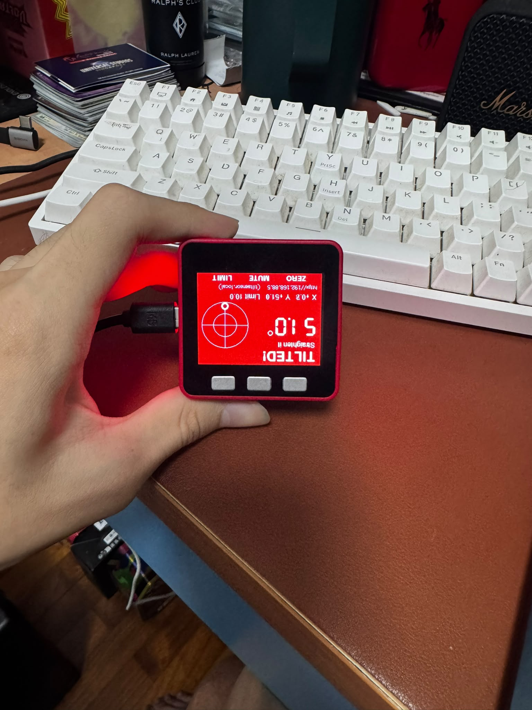
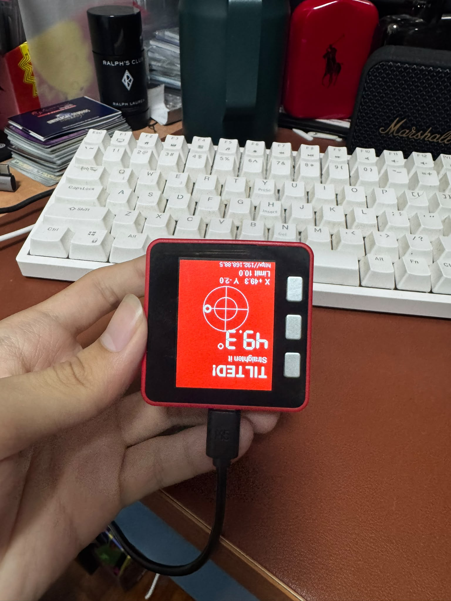

# M5Stack Fire Tilt Sensor

A tilt alarm built on the **M5Stack Fire** (ESP32 + MPU6886 IMU). It measures how far the device is tilted from a "level" position you set. If it tilts too far, it:

- turns the screen and the side LED bars **red**, and beeps,
- sends a **push notification to your phone** (via [ntfy.sh](https://ntfy.sh)),
- shows the alarm on a **live web dashboard** served by the device over Wi‑Fi.

When it's back within the limit, everything goes **green** again.

## 🎥 Demo videos

| 1. Main demo | 2. Limit + web dashboard controls |
|---|---|
| [](https://youtube.com/shorts/oyhKpcI64IE) | [](https://youtu.be/x5wJCI2qH80) |
| The tilt sensor in action. ▶️ **[Watch](https://youtube.com/shorts/oyhKpcI64IE)** | Testing the alarm limit, and using the website to mute the beeper, set the tilt limit, and reset the level (zero) position. ▶️ **[Watch](https://youtu.be/x5wJCI2qH80)** |

---

## Features

| | |
|---|---|
| **Tilt measurement** | Angle from your chosen "level" position, in any mounting orientation, with X/Y components and a bubble-level graphic |
| **3 states** | 🟢 LEVEL · 🟠 CAREFUL (above 70% of the limit) · 🔴 TILTED! (over the limit for 0.5 s) |
| **Alarm** | Flashing red screen, flashing red LED bars, beep every second. Hysteresis stops it flickering at the limit |
| **Web dashboard** | `http://<device-ip>` or `http://tiltsensor.local`: live status, bubble level, limit slider, zero/mute buttons, event log, optional browser beep |
| **Phone push** | ntfy.sh notification on "Tilt alarm!" and "Tilt OK again" |
| **Auto-rotate screen** | Layout follows how the device is held: landscape, upside-down landscape, or portrait both ways |
| **Wi‑Fi fallback** | If home Wi‑Fi fails, it starts its own hotspot `TiltSensor` and keeps retrying home Wi‑Fi in the background |
| **Saved settings** | Level position, limit and mute are kept in flash and survive a power cycle |

### Buttons (buttons at the bottom)

| A (left) | B (middle) | C (right) |
|---|---|---|
| **ZERO**: current position becomes "level" | **MUTE / UNMUTE** beeper | **LIMIT**: cycle 5 / 10 / 15 / 20 / 30° |

---

## How it works

```
 MPU6886 accelerometer ──► low-pass filter ──► "down" vector ──► angle vs. saved level vector
                                                                       │
                     ┌─────────────────────────┬──────────────────────┼──────────────────┐
                     ▼                         ▼                      ▼                  ▼
            screen (green/amber/red)     LED bars + beep      web dashboard (JSON)   ntfy push
```

- **Tilt** = angle between the smoothed gravity vector and the vector saved when you press ZERO. This works no matter how the device is mounted (flat, upright, sideways).
- **Smoothing** is a time-based low-pass filter (τ ≈ 0.25 s, or 1 s while being shaken).
- **Screen rotation** uses the same accelerometer data. It only switches after the new orientation has been held for 0.4 s, and it's ignored while the device lies flat.
- **Push notifications** run on a separate FreeRTOS task, so a slow HTTPS request never freezes the screen.

### Web API

| Method | Path | Description |
|---|---|---|
| GET | `/` | Dashboard page |
| GET | `/api/status` | JSON: tilt, x, y, limit, alarm, warn, muted, events |
| POST | `/api/zero` | Set current position as level |
| POST | `/api/limit?deg=12.5` | Set alarm limit (1–60°) |
| POST | `/api/mute?on=1` | Mute (`1`) / unmute (`0`) the beeper |

---

## Setup

1. Install [PlatformIO](https://platformio.org/) (VS Code extension or CLI).
2. Copy `include/secrets.example.h` to `include/secrets.h` and fill in:
   - your **2.4 GHz** Wi‑Fi name and password (case-sensitive!),
   - optionally an **ntfy topic**: install the ntfy app, subscribe to a hard-to-guess topic name, and put it here.

   `secrets.h` is git-ignored, so your password is never committed.
3. Plug in the M5Stack Fire with a **data** USB‑C cable and run:
   ```bash
   pio run -t upload
   ```
4. The screen shows the dashboard address. Place the device in its "level" position and press **A (ZERO)**.

Tuning (limit, warning zone, alarm delay, volume, LED brightness, auto-rotate) is in [`include/config.h`](include/config.h).

---

## Challenges I faced (and how they were solved)

### 1. Device not detected over USB
The Fire didn't show up as a COM port at all. Only Bluetooth serial ports were listed.
**Cause:** a loose or charge-only USB cable. The CP210x driver was already installed (Windows remembered it as COM5).
**Fix:** a proper data cable plugged in firmly. Later, uploads sometimes failed with `No serial data received` after the device had been moved around; unplugging and replugging fixed it every time.

### 2. Wrong board in the PlatformIO project
The project had been created for `controllino_mini` (an AVR board), not the ESP32-based M5Stack Fire.
**Fix:** switched `platformio.ini` to `board = m5stack-fire` and added the M5Unified and NeoPixel libraries.

### 3. Wi‑Fi wouldn't connect
- **Wrong password case.** `WL_CONNECT_FAILED` (status 5) meant the router was found but rejected the login. The password is **case-sensitive** and one letter had the wrong case.
- **Router sometimes rejects the ESP32's first attempts.** Even with the right password it needed 3 tries, and once all 4 failed.
  **Fix:** up to 4 connection retries at boot, a Wi‑Fi scan in the serial log when it fails, and a hotspot fallback that keeps retrying home Wi‑Fi every 20 s and switches over automatically.

### 4. Screen auto-rotate was wrong, twice
| Bug photo | What happened |
|---|---|
|  | Buttons at the bottom, but the landscape screen is drawn **upside down** |
|  | Buttons on the right, portrait screen also **upside down** |

**Cause:** I assumed the IMU's X/Y axes line up with the screen. On the Fire the IMU is mounted **rotated 90°**: +X points to the screen's top edge and +Y to its left edge. The first guess was a quarter turn off. Swapping left/right didn't help, because that's a 180° change and the error was 90°. The next attempt rotated the wrong way and left everything 180° off, as in the photos above.
**Fix:** worked out the true axis directions from the angle readings visible in the photos, then remapped *accelerometer quadrant → screen rotation*. Lesson: **log raw sensor axes first** instead of trusting assumptions about chip orientation.

### 5. Tilt reading "moved by itself" while lying still
Lying flat on the table, the reading swung between 13° and 93°.
**Diagnosis:** added raw accelerometer/gyro values and the sample rate to the serial log. The accelerometer was perfect (0.01, 0.02, 1.00 g). But the IMU was only being read **~18 times per second**, because each full-screen redraw blocks the loop. The original design fused the gyro into the angle (a complementary filter). Integrating the gyro that slowly built up large errors whenever the device was handled, and the estimate then crawled back over several seconds.
**Fix:** tilt is now calculated **directly from the accelerometer** (gravity), with a time-based low-pass filter. Gravity doesn't drift, so the reading can't wander. Result: **0.1–0.35° jitter lying flat**, down from swings of tens of degrees.
Lesson: the gyro measures *rotation speed*, not angle. For a static tilt alarm the accelerometer is the right sensor, and gyro fusion only helps with a fast, steady sample rate.

### 6. Zeroed in the wrong position
After pressing ZERO while holding it upright, lying flat read about 70°. That's expected behaviour: "level" is whatever position you zero in. Zero it in the position it will actually be used in.

---

## Project structure

```
├── platformio.ini            board, libraries
├── include/
│   ├── config.h              tuning: limit, delays, volume, rotation
│   ├── secrets.example.h     template for Wi-Fi / ntfy (copy to secrets.h)
│   └── web_page.h            dashboard HTML/JS (served from flash, works offline)
├── src/main.cpp              IMU, alarm logic, screen, LEDs, buttons, web server, push
└── docs/                     photos
```

## Hardware

- [M5Stack Fire](https://docs.m5stack.com/en/core/fire): ESP32, 320×240 display, MPU6886 IMU, speaker, 2×5 SK6812 LED bars, 3 buttons
- USB‑C **data** cable

## Status / next steps

- [x] Tilt measurement, alarm, LEDs, beeper
- [x] Web dashboard + phone push notifications
- [x] Auto-rotating screen
- [x] Stable readings (accelerometer-only filter)
- [x] Demo videos: [main demo](https://youtube.com/shorts/oyhKpcI64IE), [limit + web dashboard controls](https://youtu.be/x5wJCI2qH80)
